# Inventory & Costing

Authoritative stock and valuation rules. Implemented exclusively by `StockLedgerService`
(and, for production, in conjunction with `PostingService`). Sources of truth:
`stock_ledger` (append-only) → `stock_balances` (materialized, reconciled).

## 1. Warehouse model

| Type | Purpose | Notes |
|------|---------|-------|
| `main` | Primary stock | |
| `branch` | Branch stock | |
| `representative_custody` | One per rep — auto-created idempotently at role assignment (D-022-family; FR-050) | `representative_id UNIQUE` |
| `quarantine` | Damaged/expired/returned-pending-inspection | Issues blocked; exits only via inspection outcome |
| `in_transit` (virtual) | Stock between warehouses | No direct ops; only transfer engine writes |

Availability = `on_hand − reserved`, per warehouse/product(/lot). **Negative stock blocked by default** at DB + service level; per-warehouse opt-out requires explicit config + permission and is audited (D-008).

## 2. Stock ledger

`stock_ledger`: `id, tenant_id, product_id, warehouse_id, lot_id?, movement_type, qty_in, qty_out, uom, qty_base, unit_cost?, source_type, source_id, effect_kind, business_date, occurred_at, actor, idempotency UNIQUE(tenant, source_type, source_id, effect_kind, …)`.

| movement_type | Effect | Typical source |
|---------------|--------|----------------|
| receive | +qty | goods receipt, opening stock, production output, transfer acceptance |
| issue | −qty | invoice post (normal + free lines), production consumption, scrap |
| transfer_out / transfer_in | −/+ | transfers (via in-transit pair writes) |
| adjustment+ / adjustment− | ± | approved counts, settlement adjustments, discrepancy resolution |
| return_in | +qty | customer return (to sellable or quarantine per inspection) |
| return_out | −qty | purchase return |
| reversal_of_<any> | inverse | compensating movement of a reversal |

Balance update happens **in the same transaction**, locking the balance row
`FOR UPDATE`; insufficient available → `DomainError(INSUFFICIENT_STOCK)` before any
write. Two users cannot sell the same unit (INV-15): the row lock serializes issues and
the check happens after the lock.

## 3. Costing (D-009)

**Weighted Moving Average per (warehouse, product)**:
`new_avg = (old_qty×old_avg + in_qty×in_cost) / (old_qty + in_qty)`, computed in decimals
on each receipt-type movement; issues use current average (*before* the issue).
Expiry-tracked products: issues select lots by **FEFO** (earliest expiry, then FIFO);
lot movement rows carry the **actual lot cost** so production consumption and recalls
are lot-accurate even under WAC valuation. Inventory valuation report = Σ ledger-derived
balances × policy cost; must equal GL inventory control (ACCOUNTING_POLICY §7).

**Zero-cost guard**: any posting-path receipt/issue whose cost resolves to 0/NULL without
an explicit policy (e.g., opening stock with cost approval, gift receipts via configured
mapping) is **blocked** with `ConfigurationError`/`ValidationError` (FR-028, INV-17).

### Worked WAC example
Opening: 100 kg @ 10.00 (avg 10.00) → Receive 50 kg @ 12.00 ⇒ avg = (100×10 + 50×12)/150 = 10.6667
→ Issue 30 kg @ 10.6667 → ledger keeps full precision; GL rounds at entry total level (D-003).

## 4. Batches / lots & expiry

`stock_lots(batch_no, product_id, expiry_date?, unit_cost, source_doc)` created at
receipt. Expiry-tracked products: issue UI + POS default to suggested FEFO lot (manual
override permitted + logged). Reports: expiry horizon (30/60/90 days, configurable),
expired stock (auto-flag → quarantine move on approval), lot genealogy for
raw → production → customer recall (Phase 5).

## 5. Transfers (state machine)

```mermaid
stateDiagram-v2
    [*] --> draft
    draft --> dispatched: accountant dispatch (lock source stock)
    dispatched --> in_transit: transfer_out posted; rep notified
    in_transit --> partially_received: accept some lines (or less than dispatched)
    in_transit --> received: full accept
    partially_received --> received: remainder accepted later
    partially_received --> disputed: discrepancy recorded w/ reasons
    disputed --> resolved: accountant resolution (adjustment docs)
    resolved --> closed
    received --> closed
    dispatched --> cancelled: pre-transit cancel by dispatcher
    closed --> [*]
```

Rules: `received_qty ≤ dispatched_qty` (CHECK); acceptance writes are unique per
transfer-effect (no double receive — INV-07); discrepancies never silently write off —
they follow P-14 into an investigation balance **after** accountant resolution; rep
custody only increases on **acceptance** per the dispatch/acceptance policy (config:
accept-implied vs explicit-accept required — default explicit).

## 6. Counts & adjustments

Physical count → variance lines → **approval** → adjustment movements (P-15). Damaged /
expired / missing → quarantine → inspection outcome: restock, scrap, or supplier return.
Reservation: soft-hold qty with TTL; confirms convert to issue or release.

## 7. Customer returns (incl. van sales)

Return document references original invoice; qty caps enforced (sold − already returned).
Goods route: sellable → custody/main warehouse (return_in); damaged/expired → quarantine
pending inspection. Customer-facing: credit note or refund receipt per payment state.
Stock and GL effects are one tx (P-05).

## 8. Production inventory interface (Phase 5)

Consumption = `issue` from raw warehouse with **actual lot cost** into WIP/clearing
(P-17); output = `receive` at computed cost (P-18); scrap as P-20/P-21. Cost inputs
(materials must have lot cost; labor/overhead mappings) validated **before** starting a
batch; final costing/posting blocked when missing (FR-028).

## 9. Concurrency & reconciliation guarantees

- Balance rows locked for every mutation; counters locked per numbering event.
- Nightly `reconcile-stock` job: rebuilds expected balances from ledger → compares → drift raises `InvariantViolation` alert + read-only investigation screen (never auto-correct).
- Tests: parallel issues of last unit (only one succeeds); transfer double-accept rejected; sync-replay of same op idempotent (INV-05/06/07/15).

## 10. Free goods (inventory side)

Free lines are real `issue` movements at full cost into `Free goods expense` (D-021),
visible separately in movement+valuation reports (qty and cost), and included in rep
custody settlement as "free quantities" — never invisible stock leakage.
