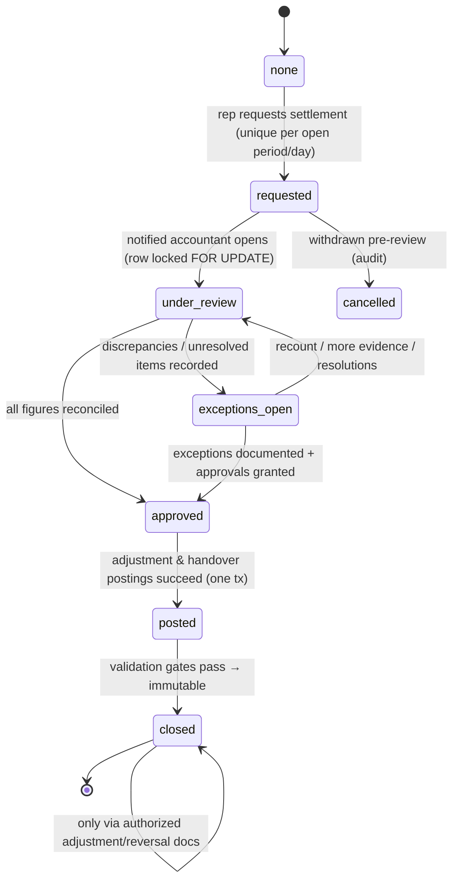

# Van Sales Workflow — Representative Lifecycle & Settlement

The complete field-sales operational contract between representative, accountant, and
system. Offline mechanics: OFFLINE_SYNC.md. Tax mechanics: INVOICING_AND_ZATCA.md.

## 1. Provisioning (administrator flow)

1. Create/select **employee** → assign **Field Sales Representative role** → create **user account** → grant permissions (scopes: branches, customers, products, price policy, operations).
2. On role assignment the system **idempotently creates exactly one custody warehouse** (`warehouses.type=representative_custody`, `representative_id UNIQUE`): repeated assignment is a no-op; race conditions can't duplicate (unique constraint + upsert semantics). Acceptance test AC-001/AC-002.
3. A **van sales device** must be registered (device record + credential) before sync; revocation disables push/pull and triggers local-wipe guidance (SECURITY_AND_TENANCY §7).
4. Removing the rep role: blocks if custody (stock or cash) is non-zero unless a settlement/transfer plan is recorded; **never deletes history** — account disables, custody records remain.

## 2. Custody model

- Stock custody lives in the rep's custody warehouse; **sales = issue from custody warehouse** (same StockLedgerService as everything else).
- Cash custody = `rep cash custody` control account per rep; collections accumulate until handover posting (P-24).
- E-payments are tracked as transactions with **settlement status**; selecting "card" is never cash (FR-031).

## 3. Transfer dispatch → acceptance (daily load-up)

1. Accountant creates transfer (official document: source warehouse → custody warehouse), records lots where applicable, marks **dispatched** → stock moves to in-transit → rep notified.
2. Rep compares delivered goods (online **and offline**); actions per line: accept-all, accept-partial (received qty), dispute (qty + reason + photo optional).
3. Acceptance (full/partial) posts transfer_in to custody; disputed/short remainder stays in-transit flagged for accountant resolution (P-14) — no silent write-offs.
4. Double receive prevented (unique acceptance effect + `received ≤ dispatched`); receiving a cancelled/closed transfer rejects with clear message.

## 4. Representative POS day

- Catalog/customers/prices pre-cached at sync; customer credit rules **cached with limits + server re-validation at sync** (offline guardrails: OFFLINE_SYNC §6).
- Cash & credit invoices, free-goods lines, authorized discounts/overrides (server-boundary re-check), returns & damaged capture, collections (cash/e-payment/bank transfer), expense claims with evidence.
- Every doc carries client `op_id` (UUIDv7) + local number; official number assigned at posting; visible **invoice status** (draft/synced/posted/tax state) and **sync status** (pending/syncing/synced/rejected/conflict).
- Save dialog = same Action A (Save & Post when eligible & online) / Action B (draft) contract as ERP POS; drafts are labeled non-final and cannot be printed as tax invoices (INVOICING_AND_ZATCA §5).

## 5. Settlement — full workflow (replaces any "close shift" button)

### 5.1 Reconciliation screen (all figures from authoritative transactions; each drillable to sources)

| Section | Expected (system) | Counted/actual | Diff |
|---------|------------------|----------------|------|
| Opening custody (per product/lot) | ledger-derived | — | — |
| Stock received & accepted | transfers accepted | — | — |
| Sales (per product/invoice, incl. free qty) | invoices | — | — |
| Customer returns | return docs | inspected qty | route to quarantine |
| Damaged / expired / missing | claims | inspected | discrepancy |
| **Ending stock** | computed (open+received−sold+returns−damaged) | physical count | **shortage/overage** |
| Cash: sales + collections − expenses − handover | computed custody | counted cash | **diff** |
| E-payments | transactions | settlement status per provider | pending list |
| Bank transfers | records | confirmed | pending |
| Credit sales / customer receivables | open allocations | — | review |
| Expenses + evidence | claims | reviewed/approved | rejected list |
| Unresolved: sync conflicts, pending transfers/returns | system | — | must resolve or policy-approve |

### 5.2 Accountant review capabilities

Count entry; return/damage inspection outcomes; per-expense approve/reject; handover matching; e-payment reconciliation; receivables review; verified discrepancy recording; recount request (moves back to review); approval path for normal settlement; **documented adjustment approvals under explicit permissions** (P-25/P-26/P-27); escalation of disputes (status stays exceptions_open + notify owner).

### 5.3 Discrepancy policy (binding — D-022)

1. Every shortage/overage first becomes a `settlement_exception` (type, calc snapshot, evidence, people, approvals). **No automatic employee debt; no automatic payroll deduction; no silent balance change.**
2. Resolution requires investigation note + authorized approval; postings use configured mappings (P-25/26/27).
3. Surpluses are documented and reconciled identically.
4. Payroll deduction, if any, is a separate legal/policy-gated action (OQ-5).

### 5.4 Finalization gate (all must hold)

Stock section: zero diffs or approved exceptions · Cash: zero diff or approved exception · e-payments: none `initiated/unknown` unresolved · expenses: all reviewed · pending transfers/returns/sync conflicts resolved or policy-approved · all postings committed · validation rules pass. Two accountants can't finalize concurrently: settlement row `FOR UPDATE` from review-open through commit. Post-closure: **immutable**; changes only via authorized adjustment/reversal documents; rep notified with final figures & references (no other users' data).

## 6. Notifications (contract)

| Event | To | Content |
|-------|----|---------|
| Transfer dispatched | rep | lines, lots, value |
| Discrepancy recorded | accountant | transfer ref, lines, reasons |
| Settlement requested | accountant(s) | rep, day, summary counts |
| Settlement approved/closed | rep | final results, exception refs, handover ack |
| Settlement exception approved | rep + owner | outcome + doc refs |
| Sync conflict/rejection | rep (+ accountant for blocked docs) | actionable fix |

## 7. Commission hooks

Sales attribution on every line; commission calculated from posted, settled-filtered data per rule (Phase 4 calc, visible in reports; payout via HR flow P-29). Settlements with unresolved exceptions exclude affected docs from commission until resolved (config flag).

## 8. Offline constraints applied here (summary)

Acceptances, invoices, collections, and settlement **requests** work offline within configured caps; settlement **review/finalization is online-only** (needs locks + authoritative counts). Offline issuance of tax-sensitive documents follows INVOICING_AND_ZATCA §7 and OQ-2/OQ-3 blocks.
